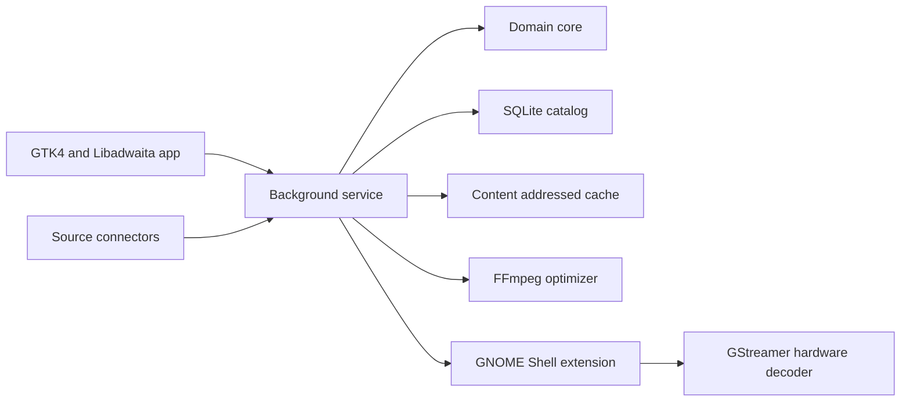

# Architecture

Motion is a native GNOME live wallpaper manager for Fedora. It owns discovery,
licensing metadata, downloads, optimization, policy, and user settings. A small
GNOME Shell extension owns the desktop surface because ordinary GTK windows cannot
join GNOME Shell's background layer on Wayland.

## Components

`motion-core` contains source neutral models and deterministic policy. It has no
GTK, network, database, process, or desktop dependencies.

`motion-service` will perform serialized network requests, downloads, catalog
updates, cache cleanup, schedules, and desktop session monitoring. Expensive work
runs only after an explicit request or a low frequency timer.

`motion-gtk` will provide the native adaptive interface. It talks to the service
over D-Bus so closing the window does not stop schedules or playback policy.

`gnome-extension` will create one background actor per monitor and play the active
local file through GStreamer. The service controls it over D-Bus. This boundary is
required for GNOME Wayland and keeps shell code small.

## Source policy

Wikimedia Commons is the only automatic connector in the first release. Its APIs
support programmatic reuse, but every media item has its own license. The connector
accepts only public domain, CC0, CC BY, and CC BY-SA video, stores the creator and
license fields, and exposes attribution in the UI. Unknown licenses are rejected.

Requests use a descriptive user agent, gzip, `maxlag`, serial pagination, caching,
and exponential backoff. Third party services are not added until their current
API terms explicitly allow an automated wallpaper browser. Local file import is a
separate connector and never infers reuse rights.

## Media pipeline

Original downloads are temporary. FFmpeg validates the input, drops audio, limits
output to 1920 by 1080 and 30 FPS, and encodes VP9 WebM by default. A hardware H.264
path is optional when VA-API is available. Thumbnails are seeked JPEG frames. Cache
entries use a source ID plus content digest and are committed with atomic renames.

The original is removed after successful optimization. Favorites, playlist items,
and the active wallpaper are pinned. Least recently used unpinned files are deleted
when the configured storage limit is exceeded.

## Runtime policy

Playback pauses when GNOME reports a fullscreen window, GameMode is active, power
saver is active, or battery charge crosses the configured threshold. Conditions
are event driven over D-Bus, not polled. The extension requests hardware decoding
from GStreamer and keeps a single pipeline per monitor. Idle service work is timer
driven, with no busy loops.

The service stores the last active item and starts through a systemd user unit after
the graphical session. Schedules and random mode select only locally available,
licensed items. User actions always override background changes.

## Delivery

The Flatpak package includes the app and service but installs the GNOME Shell
extension through the supported extension workflow. The Fedora RPM installs the
binary, desktop metadata, systemd user unit, and extension. CI runs formatting,
Clippy, unit tests, integration tests with mock HTTP and D-Bus peers, Meson builds,
Flatpak manifest validation, and RPM builds.