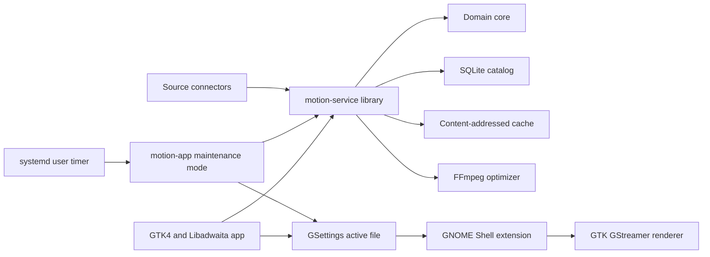

# Architecture

Motion is a native GNOME live wallpaper manager for Fedora. It owns discovery,
licensing metadata, downloads, optimization, policy, and user settings. A small
GNOME Shell extension owns the desktop surface because ordinary GTK windows cannot
join GNOME Shell's background layer on Wayland.

## Components

`motion-core` contains source neutral models and deterministic policy. It has no
GTK, network, database, process, or desktop dependencies.

`motion-service` performs network requests, bounded downloads, catalog updates,
cache cleanup, and media optimization. It is a Rust library used by both the UI
and the headless maintenance mode, not a resident daemon.

`motion-app` provides the native adaptive interface. `motion-app --maintenance`
refreshes saved searches, rotates locally available wallpapers, and enforces the
cache limit. A low-frequency systemd user timer invokes it after the UI closes.

`motion-renderer` opens one shared GTK media stream and one surface per monitor.
`gnome-extension` launches it as a compositor-owned Wayland client, clones those
surfaces into GNOME background actors, and controls play and pause over the
renderer application action group. This boundary is required on GNOME Wayland.

## Source policy

Wikimedia Commons is the only automatic connector in the first release. Its APIs
support programmatic reuse, but every media item has its own license. The connector
accepts only public domain, CC0, CC BY, and CC BY-SA video, stores the creator and
license fields, and exposes attribution in the UI. Unknown licenses are rejected.

Requests use a descriptive user agent, gzip, `maxlag`, small result limits, bounded
parallel preview downloads, and cached results. Third-party services are not added
until their current API terms explicitly allow an automated wallpaper browser.

## Media pipeline

Original downloads are temporary. FFmpeg validates the input, drops audio, limits
output to 1920 by 1080 and 30 FPS, and encodes VP9 WebM. Thumbnails are seeked JPEG
frames. Downloads are content-addressed and optimized files are committed with
atomic renames.

The original is removed after optimization succeeds or fails. Favorites, playlist
items, and the active wallpaper are pinned. Least recently used unpinned files are
deleted when the configured storage limit is exceeded.

## Runtime policy

Playback pauses when GNOME reports a fullscreen window, GameMode is active, power
saver is active, or battery charge crosses the configured threshold. Conditions
are event driven over D-Bus, not polled. The extension requests hardware decoding
from GStreamer and shares one media stream across monitor surfaces. Idle work is
timer driven, with no busy loops.

The catalog stores the last active item. GNOME restores it through the persisted
GSettings active file, while systemd starts only short-lived maintenance work.
Rotation and random mode select only locally available, licensed items.

## Delivery

The Fedora RPM installs both binaries, desktop metadata, the GSettings schema,
systemd user timer, and Shell extension. The Flatpak contains the app and renderer;
its host integration helper installs the Shell extension, schema, and a timer that
invokes Flatpak maintenance. CI runs formatting, strict Clippy, tests, metadata and
extension validation, and package builds.